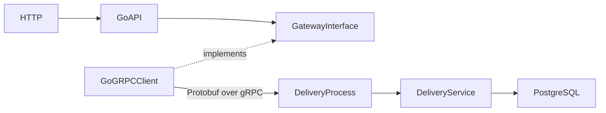

## Docker-проверка 19.11.2026

Все шесть сервисов запущены: API, delivery, worker, scheduler, PostgreSQL, Redis. Прошли 18 тестов Go без пропусков (без -race). Живое демо назначило курьера через gRPC, закрыло чужую доставку (403), получило три учебных статуса и два автоответа чата, завершило доставку. При остановке delivery API вернул 504 по дедлайну, меню продолжило отвечать 200. После запуска delivery запрос снова вернул 200 без перезапуска API. Данные: evidence/docker-verification.json, docker-tests.txt, grpc-demo.json, docker-failure-demo.json. Ниже сохранены материалы предыдущего отдельного запуска.

# Практическая работа 6

Вынос доставки в Go gRPC-сервис

Работа выполнена на Mac с Go 1.27.0 (darwin/arm64), PostgreSQL 14.20 и Redis 8.10.2. Исходный учебный проект — Сириус.Еда. Компоненты запускаются отдельными локальными процессами. Язык реализации — Go.

## Цель

Вынести доставку в отдельный процесс, сохранить HTTP-интерфейс и обработать ошибки сети.

## Выполненная работа

Контракт proto/delivery.proto содержит AssignCourier, CompleteDelivery, GetDelivery, TrackDelivery и ChatWithCourier. Код сообщений и заглушек сгенерирован protoc с Go-плагинами и включён в проект.

HTTP-обработчик зависит от интерфейса delivery.Gateway и использует rpcdelivery.Client. Прямой SQL-адаптер доставки в HTTP-приложении не создаётся. Правила доставки и репозиторий исполняются cmd/delivery в отдельном процессе. Общая PostgreSQL сохранена как переходный этап Strangler Fig, как в примере задания; выделение собственной БД не заявляется выполненным.

Unary-вызовы имеют дедлайн 5 секунд. Канал переиспользуется и закрывается с API. NOT_FOUND, PERMISSION_DENIED, UNAVAILABLE, DEADLINE_EXCEEDED преобразуются в HTTP 404, 403, 503, 504. gRPC слушает 127.0.0.1:50051, требует внутренний ключ, получает актуальные роль и состояние пользователя из БД.

TrackDelivery отправляет три статуса с интервалом 2 секунды: in_progress → on_the_way → delivered. Поле simulated=true маркирует учебную последовательность; фактический статус и координаты она не меняет.

ChatWithCourier — двунаправленный поток. Клиент отправляет сообщение, получает ответ и затем отправляет следующее в той же сессии. Сервер возвращает учебный автоответ; реальный курьер к чату не подключён.

## Проверка

`./bin/grpcdemo` выполняет реальный HTTP → gRPC сценарий. В evidence/grpc-demo.json сохранены 401 без токена; 403 для чужой роли, заказа и доставки; назначение курьера; три статуса потока; два сообщения чата; завершение доставки со статусом completed.

В evidence/native-tests.txt сохранены тесты с -race. Дополнительно проверены недействительный внутренний ключ, чужой курьер, закрытый порт, управляемый дедлайн и HTTP 503 при недоступном gRPC.

## Вывод

Доставка работает отдельным Go-процессом, а остальные модули остаются в HTTP-приложении. Вынос выполнен постепенно; переход на собственную БД доставки и реальную маршрутизацию чата остаётся отдельным развитием проекта.

## Проверка актуальной версии 03.11.2026

После удаления заготовок выполнено 18 тестов с детектором гонок Go; пропущено 0. PostgreSQL и Redis были временными, на отдельных портах 58032 и 58079. Постоянные процессы практических не запускались. Результат: evidence/scope-tests.txt и evidence/scope-verification.json.
